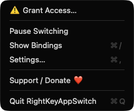
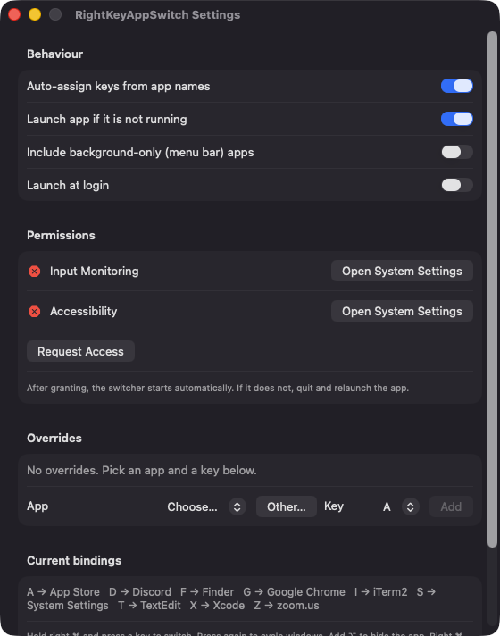

# RightKeyAppSwitch

**🌐 Website:** [turhe123.github.io/right-key-app-switch](https://turhe123.github.io/right-key-app-switch/)

Hold the right Command key and tap a letter to jump straight to an app or cycle its windows.

> 🆓 A free, open-source **rcmd alternative** for macOS 14+. Native Swift, no accounts, no subscriptions, MIT licensed.


## Why

RightKeyAppSwitch is a free, open-source, 100% native, backend-free alternative to paid utilities in the *Menu Bar Utility* category. It was inspired by rcmd ($15 one-time), which pioneered the idea of turning the right Command key into an app launcher. Everything here runs locally: there is no server, no account and no network code.

## Features

- **Right ⌘ + letter/digit** activates the app bound to that key (`a`–`z`, `0`–`9`).
- **Cycle windows:** pressing the key again while the app is frontmost raises its back-most window, so repeated presses walk through all of them. Minimized windows are unminimized.
- **Automatic key assignment** from app names: first letter, then the second letter, then the next free letter. Existing assignments stay stable as apps launch and quit, so muscle memory doesn't shift.
- **Manual overrides** in Settings, including apps that aren't running (pick via "Other…"). Overrides are stored in UserDefaults.
- **Launch if not running** (optional): the bound app is opened when it isn't running.
- **Hide an app:** right ⌘ + ⌥ + letter hides it instead.
- **Bindings overlay:** right ⌘ + `/` shows a centered panel with app icons and key caps, dismissed when you release the key. It is also available from the menu.
- **Menu bar app** with Pause Switching, Show Bindings, Settings, Support and Quit.
- **Options:** include background-only (menu bar) apps, launch at login (`SMAppService`).
- **Safe by design:** a bare right ⌘ tap and all other shortcuts pass through untouched; events are ignored while secure input is active (e.g. password fields); the event tap re-enables itself if macOS disables it.

## Screenshots

<p align="center"></p>

<p align="center"><em>The menu bar menu gives quick access to Grant Access, Pause Switching, Show Bindings (⌘/), Settings and Support.</em></p>

<p align="center"></p>

<p align="center"><em>Settings lets you toggle auto-assignment and launch behaviour, check permissions, add key overrides and see the current right ⌘ bindings such as F → Finder and X → Xcode.</em></p>

## Install

1. Download `RightKeyAppSwitch-macOS.zip` from the [latest release](https://github.com/turhe123/right-key-app-switch/releases/latest).
2. Unzip it and move `RightKeyAppSwitch.app` to `/Applications`.
3. The app is open source and not notarized, so clear the quarantine attribute:

   ```bash
   xattr -cr /Applications/RightKeyAppSwitch.app
   ```

4. Right-click the app → **Open** the first time.

## Build from source

Requires Xcode with macOS 14+ SDK.

```bash
brew install xcodegen
xcodegen generate
xcodebuild -project RightKeyAppSwitch.xcodeproj -scheme RightKeyAppSwitch -configuration Release -derivedDataPath ./build build
```

The app is produced at `build/Build/Products/Release/RightKeyAppSwitch.app`.

## Permissions

| Permission | Why |
| --- | --- |
| **Input Monitoring** | Required to create the session event tap that detects the right Command key and your letter presses. |
| **Accessibility** | Lets the app swallow the handled key press and read/raise an app's windows to cycle them. |

Both are requested from the menu ("Grant Access…") or Settings, which shows the status of each. Once granted, the switcher starts automatically; if it doesn't, relaunch the app.

The code does not use Screen Recording, Microphone, Camera or any network access, and requests none of them.

## Built with AI

RightKeyAppSwitch was written by [Claude Code](https://claude.com/claude-code) inside an automated pipeline, from a plain-English spec. No code, binaries or assets from any commercial app were used; it is a clean-room reimplementation of a feature set, not a copy.

What that means in practice:

- The full source is in this repo under the MIT license. Read it before you run it.
- No network calls, no analytics, no third-party dependencies. Only Apple frameworks.
- Ad-hoc signed and not notarized, which is why Gatekeeper warns on first launch.
- It has had less human review than a hand-written app. Bug reports and pull requests are welcome.

## Support ❤️

If this saves you time, you can support development: [Support Or (Leo) Davidai ❤️](https://ko-fi.com/leodavidai)

The app also has a "Support / Donate ❤️" button in its menu and Settings window.

## More free Mac apps

RightKeyAppSwitch is one of [60 free, open-source Mac utilities](https://github.com/turhe123/mac-apps) built the same way: native Swift, no accounts, no telemetry. Browse the full gallery at [turhe123.github.io/mac-apps](https://turhe123.github.io/mac-apps/).

## License

MIT © Or Davidai Bachar
